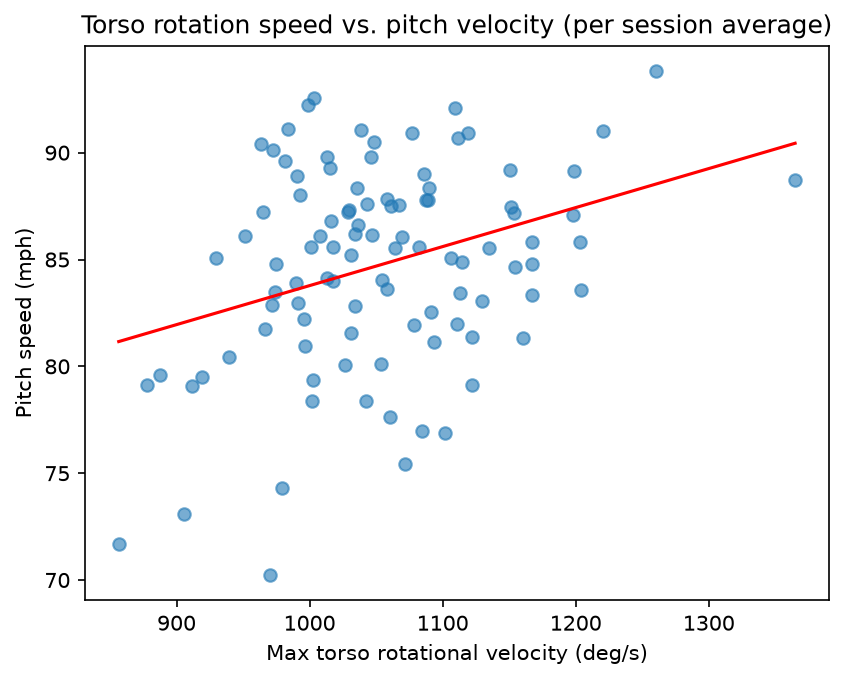

# Pitch Velocity Biomechanics Analysis

What separates pitchers who throw harder? This project uses motion capture data from Driveline's OpenBiomechanics Project to explore which body movements are most associated with pitch velocity.

## Key findings
- Peak torso rotational velocity had the strongest association with pitch speed (r = 0.33 across all pitches), and it remained the top factor after averaging by session.
- Each additional 100 deg/s of torso rotation was associated with about 1.8 mph higher pitch speed on average.
- Forward center-of-gravity velocity showed a weaker relationship, and energy flow metrics showed even weaker associations.
- No single metric explained velocity strongly, suggesting a combination of factors contributes to throwing harder.

## Data
411 fastballs from about 100 mostly collegiate pitchers, from the [OpenBiomechanics Project](https://github.com/drivelineresearch/openbiomechanics) by Driveline Baseball. The data is not included in this repo and is used under the OBP non-commercial license.

## Methods
- Selected 7 metrics covering rotation, lower-body momentum, and energy flow
- Computed correlations with pitch speed
- Averaged pitches by session to correct for repeated trials from the same pitcher
- Fit linear trend lines and compared faster vs. slower pitchers (split at median speed)

## Limitations
Results are correlational and don't show cause. The sample is mostly collegiate pitchers throwing fastballs.

## How to run
1. Clone the OpenBiomechanics repo and place this notebook in its root folder
2. Install dependencies: `pip install -r requirements.txt`
3. Open `pitch_analysis.ipynb` and run all cells

## Tools
Python, pandas, NumPy, matplotlib, Jupyter